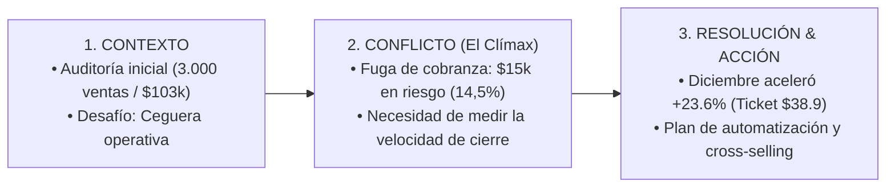

# GUION ESTRATÉGICO DE STORYTELLING EN GOOGLE SLIDES (ETAPA 4)
## Proyecto Integrador: Consultoría de Business Intelligence en E-Commerce
**Comisión:** C26228 · **Consultora:** Datawise Consulting · **Analista:** Rubén Barrios  
**Entidad:** Programa BI Consulting – Talento Tech | Ministerio de Educación / GCBA (Plan 2026)

---

## 1. El Marco Metodológico: La Tríada Narrativa de Consultoría

Toda presentación directiva de Business Intelligence de alto impacto debe estructurarse como un viaje analítico guiado por decisiones de negocio, superando la mera descripción pasiva de números:

---

## 2. El Núcleo Estratégico: Las 6 Preguntas de Negocio que Diseñaron los KPIs

El diseño de la banda superior de KPIs en Looker Studio no fue decorativo ni aleatorio; cada tarjeta se configuró para dar respuesta directa a un interrogante crítico planteado por el Directorio:

| KPI en el Dashboard | Valor & Tendencia | Pregunta Estratégica del Directorio | Decisión / Acción Orientada por el Dato |
| :--- | :---: | :--- | :--- |
| **1. VENTA NETA** | **$8,868.51** `▲ 23.6% vs Nov` | *“¿Cuánto dinero real y cobrado ingresó a la caja en el mes de cierre y a qué ritmo venimos creciendo frente al mes previo?”* | Confirma reactivación comercial de fin de año; valida el presupuesto operativo para arrancar el primer trimestre sin estrés de liquidez. |
| **2. PEDIDOS EFECTIVOS** | **228** `▲ 3.6% vs Nov` | *“¿Cuál fue el volumen de compras completadas con éxito sin cancelaciones ni abandonos de carrito?”* | Verifica estabilidad en la capacidad logística de preparación y despacho (228 órdenes despachadas sin cuellos de botella). |
| **3. TICKET PROMEDIO** | **$38.90** `▲ 19.2% vs Nov` | *“¿El aumento de facturación se debió a traer más compradores o a que los clientes actuales gastaron más por cada compra?”* | **Insight de oro:** El crecimiento provino de la **calidad del carrito** (compras navideñas y combos familiares de mayor valor), no de saturar la operación con micro-pedidos. |
| **4. UNIDADES VENDIDAS** | **819** `▲ 5.5% vs Nov` | *“¿Cuánto volumen físico de mercadería salió del almacén para negociar la reposición con proveedores clave?”* | Permite proyectar órdenes de compra a proveedores de carnes y lácteos para enero evitando roturas de stock o sobrecostos de depósito. |
| **5. CLIENTES ÚNICOS** | **189** `▲ 3.3% vs Nov` | *“¿La facturación depende peligrosamente de pocos compradores mayoristas o contamos con una base sana y diversificada?”* | Confirma que el riesgo comercial está atomizado entre 189 compradores activos distintos, con crecimiento sostenido en retención. |
| **6. INGRESOS EN RIESGO** | **$981.58** `▼ -48.0% vs Nov` | *“¿Cuánto capital de trabajo tenemos atrapado en órdenes pendientes de cobro y qué tan eficaz fue la gestión de recupero?”* | Demuestra que la cobranza proactiva **redujo el dinero retenido casi a la mitad** en diciembre, liberando flujo de caja antes del balance. |

---

## 3. Guion Diapositiva por Diapositiva (Google Slides)

A continuación se detalla el contenido visual, los textos ejecutivos y las **notas del orador en primera persona** para tu exposición oral:

---

### Diapositiva 1: Portada Ejecutiva
* **Título:** `CONSULTORÍA DE BUSINESS INTELLIGENCE | EJERCICIO FISCAL 2024`
* **Subtítulo:** `De los Datos Crudos a la Decisión Estratégica: Tablero Ejecutivo y Narrativa de Cierre`
* **Ficha Técnica:** Datawise Consulting · Rubén Barrios · Comisión C26228 · Talento Tech (Plan 2026).
* **Guion del Orador (Speaker Notes):**
  > *"Buenas tardes a los evaluadores y colegas. Mi nombre es Rubén Barrios y vengo en representación de Datawise Consulting a presentar el cierre del proyecto integral de Business Intelligence para la empresa de E-Commerce. A lo largo de esta consultoría transformamos registros transaccionales dispersos en un sistema analítico gobernado, ergonómico y orientado a la toma de decisiones directivas"*.

---

### Diapositiva 2: Contexto del Negocio y Problemática Inicial
* **Título del Insight:** `El Punto de Partida: Superar la Ceguera Comercial y el Desorden Operativo`
* **Contenido Visual:** Diagrama del flujo de datos o captura de la planilla inicial en Google Sheets.
* **Puntos Clave:**
  * **El problema de negocio:** Dispersión transaccional, desconocimiento del ticket promedio real y falta de trazabilidad en las cobranzas.
  * **La gobernanza ética y técnica:** Auditoría de 3.000 transacciones únicas con cumplimiento del 100% en el checklist de calidad (unicidad, consistencia y completitud), preservando la privacidad mediante anonimización (GDPR).
* **Guion del Orador:**
  > *"Tener miles de registros no sirve de nada si se trabaja a ciegas. La empresa no sabía con exactitud qué clientes sostenían el negocio ni cuánto dinero real ingresaba a las cuentas bancarias. Como primer paso de consultoría, consolidamos una base estricta de 3.000 ventas únicas bajo un modelo estrella relacional, garantizando datos limpios antes de cualquier visualización"*.

---

### Diapositiva 3: Arquitectura y Demostración del Dashboard en Looker Studio
* **Título del Insight:** `Tablero de Control Ergonómico: Reducción de Carga Cognitiva y Respuesta en 3 Segundos`
* **Contenido Visual:** Captura panorámica de tu Dashboard completo en Looker Studio en modo oscuro.
* **Enlace Activo:** `[🔗 Abrir Tablero Interactivo en Looker Studio]` *(pegar link compartible)*.
* **Puntos Clave:**
  * Diseño bajo leyes **Gestalt** (proximidad, contraste oscuro con acentos cian/neón y eliminación de cuadrículas redundantes).
  * Doble horizonte analítico: **Velocidad de Cierre Reciente** en los 6 KPIs superiores y **Memoria Anual Acumulada ($103k)** en los gráficos inferiores.
* **Guion del Orador:**
  > *"Para la dirección diseñamos este tablero interactivo en Looker Studio. Aplicamos la regla de los 3 segundos: un directivo debe comprender el pulso de la compañía sin buscar números en planillas. Arriba sintetizamos el mes de cierre con comparativas de período y sparklines de tendencia, y abajo disponemos de la historia anual completa con filtrado cruzado dinámico"*.

---

### Diapositiva 4: Preguntas del Directorio · ¿Por qué Diseñamos los KPIs de Cierre?
* **Título del Insight:** `La Demanda Directiva: Medir la Velocidad de Fin de Año y Auditar la Calidad del Ingreso`
* **Contenido Visual:** Recorte nítido de la fila de las 6 tarjetas de KPIs (`VENTA NETA`, `PEDIDOS`, `TICKET`, `UNIDADES`, `CLIENTES`, `INGRESOS EN RIESGO`).
* **Puntos Clave:**
  * Explicar por qué pasamos del total estático de la pre-entrega a la métrica de velocidad de diciembre ($8.868,51 y `▲ 23.6% vs Nov`).
  * Desglose del crecimiento: cómo el salto del ticket a **$38.90 (+19.2%)** fue el motor del resultado.
* **Guion del Orador:**
  > *"Al revisar la pre-entrega, el Directorio nos planteó una nueva pregunta: 'Ya vimos que juntamos $103k en el año, pero ¿cómo cerramos el último mes? ¿Estamos acelerando o desacelerando?'. Por eso diseñamos esta fila de KPIs. La respuesta fue contundente: en diciembre facturamos $8.868 netos, creciendo un 23.6% respecto a noviembre. Y lo más valioso: crecimos porque cada cliente gastó casi 20% más por pedido gracias a los combos de fin de año"*.

---

### Diapositiva 5: Hallazgo Comercial · Concentración en Categorías y Polarización Regional
* **Título del Insight:** `Carnicería y Lácteos Aportan el 42% de la Facturación; Buenos Aires y Centro Dominan el 55%`
* **Contenido Visual:** Captura del gráfico de barras horizontales (Categorías) y la tabla con mapa de calor (Regiones).
* **Puntos Clave:**
  * **Categorías tractoras:** *Carnicería* ($27.924,82) y *Lácteos* ($16.093,78) representan la locomotora de compras de la tienda digital.
  * **Desbalance geográfico:** *Buenos Aires* ($36.904) y *Centro* ($20.083) concentran la gran masa de ingresos, mientras que *NOA* ($2.456) se encuentra subexplotado a pesar de tener un ticket medio competitivo ($38.99).
* **Guion del Orador:**
  > *"Al analizar los gráficos del cuerpo central, los datos revelan una alta concentración: Carnicería y Lácteos son los productos de atracción que llenan el carrito digital. A nivel territorial, Buenos Aires y la región Centro explican más del 55% del dinero. Sin embargo, observamos un patrón interesante: el NOA, aunque tiene poco volumen, registra el ticket medio más alto ($38.99). Hay un mercado desatendido con alto poder de compra esperando ofertas específicas"*.

---

### Diapositiva 6: El Clímax Analítico · La Fuga de Cobranzas en Pedidos Pendientes
* **Título del Insight:** `El 14,5% del Dinero Anual ($14.985) Quedó Retenido por Demoras en Transferencias`
* **Contenido Visual:** Recorte del gráfico de anillo de medios de pago y la tarjeta de `INGRESOS RIESGO`.
* **Puntos Clave:**
  * De los $103.103 brutos, **$87.729 se cobraron con éxito (84,1%)**, pero **$14.985,96 quedaron pendientes en 467 pedidos**.
  * **Causa operativa:** Las transferencias bancarias representan el **26,6%** de las ventas, pero carecen de conciliación automática, dependiendo de comprobantes manuales.
  * **La buena noticia:** En diciembre el dinero en riesgo cayó un **48%** ($981 vs $1.887), demostrando que la gestión activa recupera caja.
* **Guion del Orador:**
  > *"Llegamos al hallazgo de mayor impacto para el Director Financiero: la tasa de cancelación es bajísima (solo 0,3%), pero el 14,5% de las ventas anuales quedó retenido en estado 'Pendiente'. Casi $15.000 inmovilizados porque las transferencias bancarias se concilian a mano. En diciembre logramos que este riesgo caiga un 48%, lo que demuestra que con automatización podemos rescatar este flujo de caja de inmediato"*.

---

### Diapositiva 7: Recomendaciones Estratégicas Accionables (El Retorno de Inversión)
* **Título del Insight:** `Plan de Acción Directivo: Automatización de Cobranzas, Cross-Selling y Expansión`
* **Contenido:** 3 Iniciativas de Negocio Priorizadas:
  1. **Automatización de Pasarelas de Pago:** Implementar webhooks en transferencias y fomentar billeteras virtuales (Mercado Pago al 29,6%) para reducir a cero los pedidos pendientes, liberando hasta $15.000 de capital de trabajo.
  2. **Estrategia Comercial de Cross-Selling:** Agrupar las categorías tractoras (Carnes y Lácteos) con productos de menor rotación pero alto margen (Conservas y Panadería) para sostener el ticket promedio récord de $38.
  3. **Gobernanza y Adopción:** Utilizar este Dashboard en Looker Studio como herramienta estándar en la reunión semanal de directorio para anticipar quiebres de stock.
* **Guion del Orador:**
  > *"Como consultores de BI, nuestra labor culmina diciendo qué decisiones tomar. Proponemos tres medidas concretas: primero, automatizar la conciliación de transferencias para liberar el capital atrapado en pedidos pendientes; segundo, impulsar combos entre carnes y panadería para sostener el ticket promedio récord; y tercero, institucionalizar este tablero de Looker Studio como el timón de gestión semanal del negocio. Muchas gracias"*.
