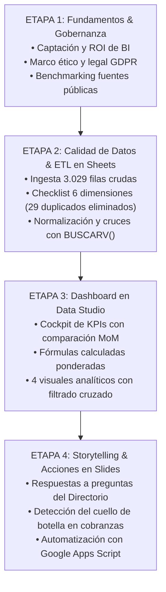
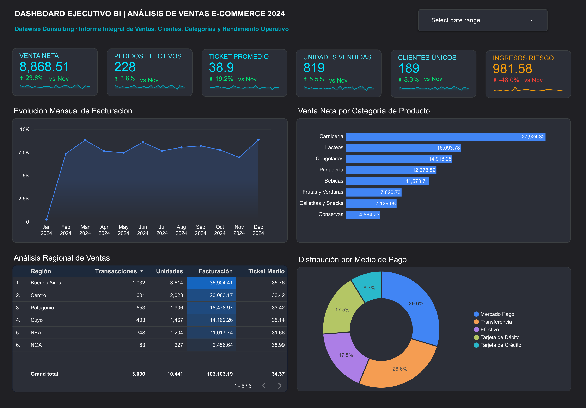

# 📊 Business Intelligence Consulting — E-Commerce End-to-End Analytics

[](https://datastudio.google.com/reporting/09567fb9-55f4-4e64-b537-4e24e1f0f8e8)
[](https://docs.google.com/spreadsheets/d/1aJiWEctzwMJkoDOK-tq6lUpjJVtE84jb_jdPk0QKgiQ/)
[](./generar_presentacion_slides.gs)
[](#)

> **Trabajo Práctico Integrador (TPI) — Programa Oficial BI Consulting (Plan 2026)**  
> **Entidad:** Talento Tech · Ministerio de Educación GCBA  
> **Consultora Ficticia:** Datawise Consulting · **Analista / BI Developer:** Rubén Barrios · **Comisión:** C26228  
> **Repositorio Oficial:** [github.com/rubenbarrios-bigdata/bi-consulting-ecommerce-analytics](https://github.com/rubenbarrios-bigdata/bi-consulting-ecommerce-analytics)

---

## 🔗 Accesos Directos a los Entregables en Vivo

* 🚀 **[Dashboard Interactivo en Data Studio (Looker Studio)](https://datastudio.google.com/reporting/09567fb9-55f4-4e64-b537-4e24e1f0f8e8)** *(Tablero ejecutivo en vivo con filtrado cruzado dinámico)*
* 📊 **[Libro Maestro en Google Sheets](https://docs.google.com/spreadsheets/d/1aJiWEctzwMJkoDOK-tq6lUpjJVtE84jb_jdPk0QKgiQ/edit?gid=1833343714#gid=1833343714)** *(Base gobernada de 3.000 ventas, fórmulas relacionales `=BUSCARV()`, estadística descriptiva y matriz de calidad)*
* 📁 **[Carpeta Oficial del Proyecto en Google Drive](https://drive.google.com/drive/folders/1PpibruN527CVEbGAh5XUH-n_kMcCEQCt)**
* 📑 **[Guion de Storytelling en Google Slides (Markdown)](./PRESENTACION_STORYTELLING_GOOGLE_SLIDES.md)** *(Narrativa directiva Diapositiva por Diapositiva con notas de análisis)*
* 🤖 **[Script de Automatización en Google Apps Script (`generar_presentacion_slides.gs`)](./generar_presentacion_slides.gs)** *(Código ejecutable para armar las 7 diapositivas en Google Slides automáticamente)*
* 📝 **[Informe Académico de Pre-Entrega (Markdown)](./INFORME_PRE_ENTREGA_BI_CONSULTING.md)** *(Fundamentos, marco ético GDPR y fuentes públicas)*
* 🌐 **[Informe Ejecutivo en Versión Web (HTML)](./INFORME_PRE_ENTREGA_BI_CONSULTING.html)**

---

## 🧭 Ciclo de Vida del Proyecto: De los Datos Crudos al Storytelling

Este repositorio documenta el **viaje completo de Business Intelligence** estructurado en las 4 etapas del plan de estudios:



---

## 🏛️ ETAPA 1 & 2: Gobernanza, Calidad y ETL en Google Sheets

### 1. Auditoría Diagnóstica de Calidad de Datos
Sobre un padrón transaccional original de **3.029 filas**, se aplicó el checklist de gobernanza en la hoja `formulario calidad de datos`:
* **Unicidad:** Se detectaron y depuraron **29 registros duplicados exactos**, consolidando una base estricta de **3.000 transacciones únicas**.
* **Completitud:** 100,0% de completitud (0 celdas vacías en identificadores `ID_Venta`, `Fecha`, `ID_Cliente`, `ID_Producto`).
* **Consistencia e Integridad Referencial:** 100% de coincidencias sin registros huérfanos entre clientes, productos y ventas.
* **Ética y Anonimización (GDPR):** Enmascaramiento de correos electrónicos y nombres de clientes siguiendo las conclusiones del caso de estudio de privacidad de datos.

### 2. Estructura de Hojas del Libro en Google Sheets

| N° | Nombre de Hoja | Propósito y Fórmulas Clave |
| :---: | :--- | :--- |
| `00` | `formulario calidad de datos` | Matriz de auditoría diagnóstica de dimensiones de calidad. |
| `01` | `01_Raw_Ventas` / `Clientes` / `Productos` | Datos crudos originales intactos (3.029 transacciones, 326 clientes). |
| `02` | `02_Limpieza_Normalizacion` | Transformaciones de texto (`ESPACIOS`, `NOMPROPIO`) y conversión de coma a número. |
| `03` | `03_Consolidado_Ventas` | Tabla maestra unificada con cruces relacionales estrella mediante `=BUSCARV()`. |
| `04` | `04_Estadistica_Descriptiva` | Métricas estadísticas: Media ($34.37), Mediana ($26.16), Moda ($12.24), Desv. Estándar ($24.97). |
| `05` | `05_Dashboard_Reporte` | Primer prototipo de reportería interna con segmentaciones y tablas dinámicas. |

---

## 📊 ETAPA 3: Tablero Ejecutivo en Google Data Studio (Looker Studio)

<p align="center">
  
</p>

Conectado de forma directa a la hoja `03_Consolidado_Ventas` (`A1:Q3001`), el reporte en Data Studio implementa una **arquitectura ergonómica (Dark Mode `#0B0F19`)** con dos horizontes analíticos:

### 1. Cockpit Superior: Velocidad de Cierre (Diciembre 2024 vs Noviembre 2024)
Diseñado para responder en 3 segundos las preguntas del Directorio:

| KPI en Data Studio | Valor Diciembre | Comparativa vs Nov | Pregunta de Negocio Respondida |
| :--- | :---: | :---: | :--- |
| **Venta Neta** | **$8,868.51** | `▲ 23.6%` | *¿Cuánto dinero real y cobrado ingresó a caja en el mes de cierre?* |
| **Pedidos Efectivos** | **228** | `▲ 3.6%` | *¿Cuál fue el volumen de órdenes completadas sin cancelaciones?* |
| **Ticket Promedio** | **$38.90** | `▲ 19.2%` | *¿El crecimiento se debió a más compras o a carritos de mayor valor?* |
| **Unidades Vendidas** | **819** | `▲ 5.5%` | *¿Qué volumen físico salió del almacén para reposición de stock?* |
| **Clientes Únicos** | **189** | `▲ 3.3%` | *¿La facturación está atomizada o depende de pocos clientes?* |
| **Ingresos en Riesgo** | **$981.58** | `▼ -48.0%` | *¿Cuánto capital quedó atrapado y qué tan eficaz fue la cobranza?* |

### 2. Métricas y Campos Calculados Implementados en Data Studio
* **Ticket Promedio Ponderado:**
  ```sql
  SUM(Precio_Total) / COUNT_DISTINCT(ID_Venta)
  ```
  *(Previene el sesgo de "promediar promedios", manteniendo exactitud en cualquier filtro).*
* **Tasa de Efectividad de Órdenes:**
  ```sql
  COUNT(CASE WHEN Estado_Nombre = 'Completa' THEN ID_Venta END) / COUNT(ID_Venta)
  ```

---

## 🔍 ETAPA 4: Principales Hallazgos y Storytelling de Negocio

### 1. El Motor del Crecimiento (Insight de Oro)
La facturación de diciembre creció un **+23.6%**, pero los pedidos solo aumentaron un **+3.6%**. El verdadero impulsor del resultado fue el salto del **Ticket Promedio a $38.90 (+19.2%)**, traccionado por la venta de combos familiares navideños de mayor valor, sin saturar la capacidad logística de empaque.

### 2. Categorías Locomotoras de la Canasta Digital
* **Carnicería ($27,924.82)** y **Lácteos ($16,093.78)** concentran el **42.7% de la facturación global**. Actúan como productos de alta recurrencia que aseguran la atracción del cliente.
* El resto se distribuye entre Congelados ($14.9k), Panadería ($12.7k), Bebidas ($11.7k), Frutas/Verduras ($7.8k), Snacks ($7.1k) y Conservas ($4.8k).

### 3. Cobertura Territorial y Oportunidad del NOA
* **Buenos Aires ($36.9k)** y la región **Centro ($20.1k)** explican el **55.3% del volumen total**.
* **El Hallazgo Oculto:** El **NOA** (Noroeste Argentino: Salta, Tucumán, Jujuy, etc.) registra un volumen menor (63 pedidos), pero ostenta el **Ticket Promedio más alto de todo el país ($38.99)**. La lejanía logística lleva al comprador a abastecerse con compras grandes, revelando un mercado de alto poder adquisitivo desatendido.

#### 📌 Glosario de Cobertura Regional (E-Commerce Argentina)
| Región | Provincias Comprendidas | Facturación ($) | % Part. | Ticket Medio ($) | Rol en el Negocio |
| :--- | :--- | :---: | :---: | :---: | :--- |
| **Buenos Aires** | CABA y Provincia de Buenos Aires | $36,904.41 | 35.8% | $35.76 | Núcleo principal de volumen |
| **Centro** | Córdoba, Santa Fe, Entre Ríos | $20,083.17 | 19.5% | $33.42 | Segundo polo industrial |
| **Patagonia** | Neuquén, Río Negro, Chubut, Santa Cruz, TDF | $18,478.97 | 17.9% | $33.42 | Demanda estable en el sur |
| **Cuyo** | Mendoza, San Juan, San Luis | $14,162.26 | 13.7% | $35.14 | Mercado de buen poder de compra |
| **NEA** | Chaco, Corrientes, Misiones, Formosa | $11,017.74 | 10.7% | $31.66 | Cobertura en el litoral norte |
| **NOA** | Tucumán, Salta, Jujuy, Catamarca, La Rioja, Sgo. | $2,456.64 | 2.4% | **$38.99** | **Récord nacional de ticket** |

### 4. Medios de Pago y el Diagnóstico de Cobranzas
* **Mercado Pago lidera con el 29.6%**, seguido de cerca por **Transferencias Bancarias (26.6%)**, Efectivo (17.5%), Débito (17.5%) y Crédito (8.7%).
* **El Clímax Financiero:** Sobre el total de $103,103.19 anuales, **$87,729.89 (85.1%)** fueron cobrados con éxito (*Completa*), pero **$14,985.96 (14.5%)** quedaron inmovilizados en estado *Pendiente*.
* **Causa Raíz:** Las transferencias bancarias carecen de conciliación automática (dependen de revisión manual de comprobantes). En diciembre, la cobranza activa logró reducir el dinero retenido un **48% ($981.58)**, liberando liquidez antes del balance anual.

---

## 🚀 Plan de Acción Estratégico (ROI para el Negocio)

1. **Automatización de Pasarelas:** Implementar webhooks inmediatos para transferencias bancarias e incentivar billeteras virtuales (Mercado Pago), reduciendo a cero los pedidos pendientes y recuperando hasta $15.000 de capital de trabajo.
2. **Estrategia Comercial de Bundling:** Crear combos asociando productos tractores (Carnes y Lácteos) con artículos de alto margen comercial (Panadería y Conservas) para sostener el ticket promedio récord de $38.
3. **Expansión al NOA:** Lanzar campañas promocionales con envío bonificado para el Noroeste Argentino, capitalizando su ticket récord de $38.99.
4. **Institucionalización de BI:** Utilizar este Dashboard en Data Studio como herramienta estándar de los comités ejecutivos semanales.

---

## 📁 Estructura del Repositorio

```text
├── categorias.csv                         # Catálogo de familias de productos
├── clientes.csv                           # Directorio de clientes normalizado
├── metodos_pago.csv                       # Catálogo de medios de pago
├── productos.csv                          # Catálogo de artículos, precios y stock
├── ventas.csv                             # Transacciones originales (3.029 filas)
├── dashboard_looker_studio.png            # Captura renderizada en alta resolución del Dashboard
├── generar_presentacion_slides.gs         # Script ejecutable de Google Apps Script (Slides)
├── PRESENTACION_STORYTELLING_GOOGLE_SLIDES.md # Narrativa completa Diapositiva por Diapositiva
├── POST_LINKEDIN_DASHBOARD_BI_DEVELOPER.md   # Post calibrado para redes profesionales
├── INFORME_PRE_ENTREGA_BI_CONSULTING.md   # Informe técnico de fundamentos y auditoría GDPR
├── INFORME_PRE_ENTREGA_BI_CONSULTING.html # Vista web del informe ejecutivo
├── Fundamentos y Calidad de los Datos.docx# Entregable editable en Word / Google Docs
├── Fundamentos y Calidad de los Datos.pdf # Entregable formal en PDF
└── README.md                              # Documentación integral del repositorio
```

---

## 👤 Autor & Consultoría

* **Rubén Barrios** — *BI Developer & Analytics Consultant*  
* **Consultora:** Datawise Consulting  
* **Comisión:** C26228 · Talento Tech (Plan de Estudios 2026)  

